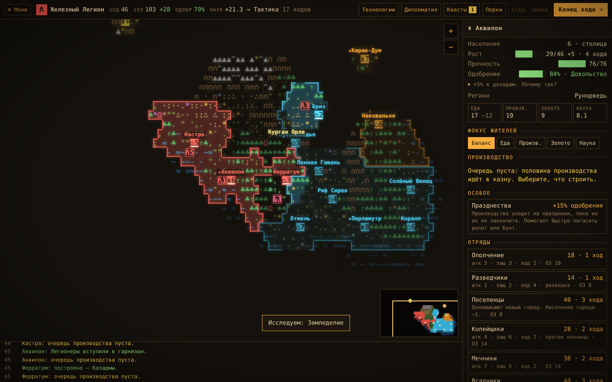
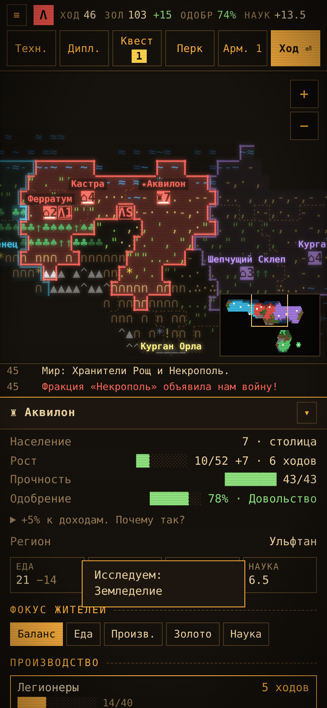

# Пепел и Эфир

Пошаговая фэнтези-стратегия в духе 4X — «расследуй, расширяйся, используй, истребляй» — плюс сюжет. Играется прямо в браузере, вся графика — цветной ASCII на «терминальном» экране. Вдохновлялась Civilization V, Stellaris и Endless Legend 2.



## Как играть

**▶ Играть в браузере: https://grivan4k.github.io/ash-and-aether/**

Можно и без интернета: скачайте `index.html` и откройте в браузере. Ни сервер, ни установка не нужны, игра работает на компьютере и на телефоне. Сохранения хранятся в браузере, ещё есть экспорт и импорт кодом.

## Что есть в игре

- **Карта и державы.** Гексагональная карта с регионами, ресурсами, логовами чудовищ и местами для квестов. Настраиваются размер карты, число игроков (2–6) и сложность.
- **Шесть готовых фракций:** Железный Легион, Хранители Рощи, Подгорные Кузнецы, Некрополь, Дети Прилива и Гильдия. У каждой своя механика, уникальный отряд и постройка, а ещё сюжетная цепочка и особые исследования.
- **Редактор фракций.** Черты выбираются за очки, к ним уникальная механика, свой отряд, постройка, цвета и символы. Фракцией можно поделиться кодом.
- **Армии и автобой.** Армии ходят по карте, бой рассчитывается автоматически, и перед атакой видно превью шансов. Отряды получают опыт и ранги, за победы дают трофеи и добычу.
- **Осада и измор.** Город, рядом с которым стоит вражеская армия, остаётся без доходов. Его стены слабеют, гарнизон голодает, а бунтующий город может сдаться без боя.
- **Одобрение.** Слишком много городов и жителей вызывает недовольство: ропот, бунты, мятежники. Помогают праздники, храмы и ресурсы роскоши.
- **Исследования.** Четыре эпохи, у построек есть улучшения, у фракций — особые исследования.
- **Перки державы, квесты, события, дипломатия** — войны и мир с ИИ.
- **Победы:** завоевание (захватите все исходные столицы ★) или научная (постройте Врата Эфира).



## Структура

```
src/            исходники: data, engine, combat, turn, quests, perks, approval, siege, ai, editor, ui
src/shell.html  разметка и стили страницы
build.py        собирает src/*.js и shell.html в один index.html
index.html      готовая игра одним файлом
tests/          тесты: браузерные (Playwright) и тесты движка (Node)
tourney/        турнир ботов: 100 партий на настоящем движке
```

## Сборка

```bash
python3 build.py
```

## Тесты

Нужны Node.js 18+ и Playwright с Chromium:

```bash
npm install
npx playwright install chromium
npm test
```

`npm test` пересобирает игру и прогоняет все тесты: управление и бой, квесты, редактор и перки, одобрение, опыт и трофеи, особые исследования, осаду, совместимость сохранений. Скриншоты сохраняются в `shots/`.

## Турнир ботов

```bash
node tourney/run.js 3                        # 100 партий в 3 потока → tourney/results.jsonl
node tourney/analyze.js                      # сводка
node tourney/compare.js tourney/old.jsonl    # сравнение с прошлым прогоном
node tourney/conquest.js                     # 10 партий только на завоевание
```

Бот играет за игрока разными стратегиями (`ai`, `sci`, `war`, `wide`, `turtle`, `idle`) против ИИ, всеми фракциями. Так проверяется баланс: можно ли выиграть и проиграть разными путями.
